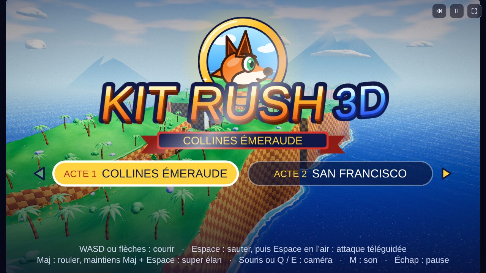
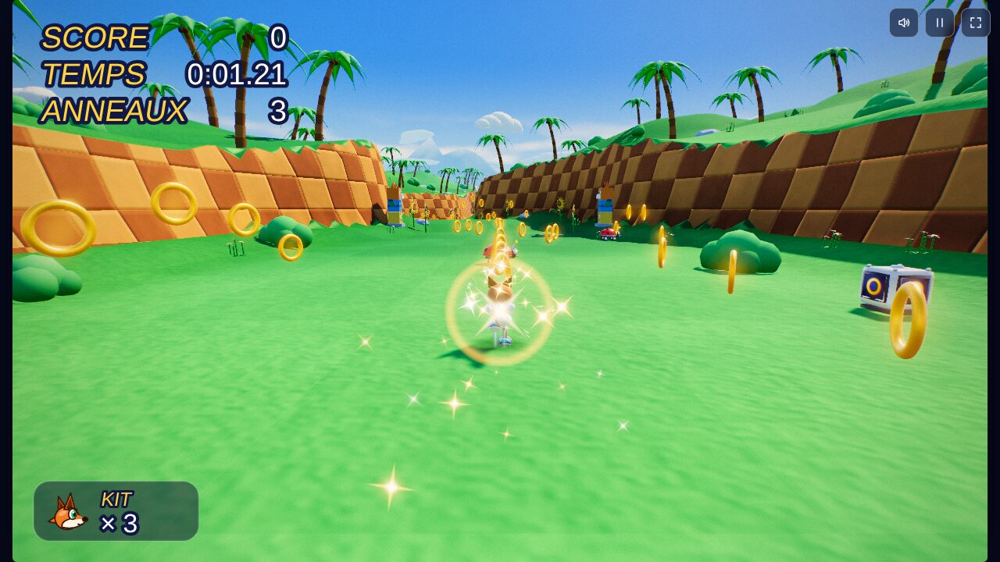
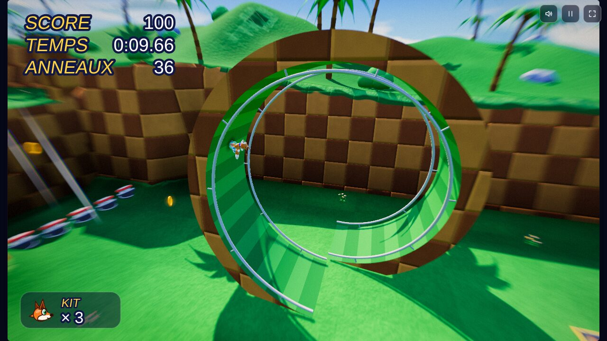
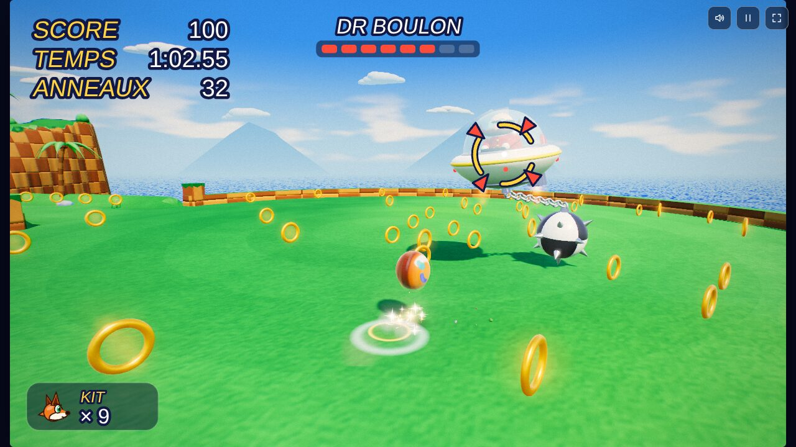
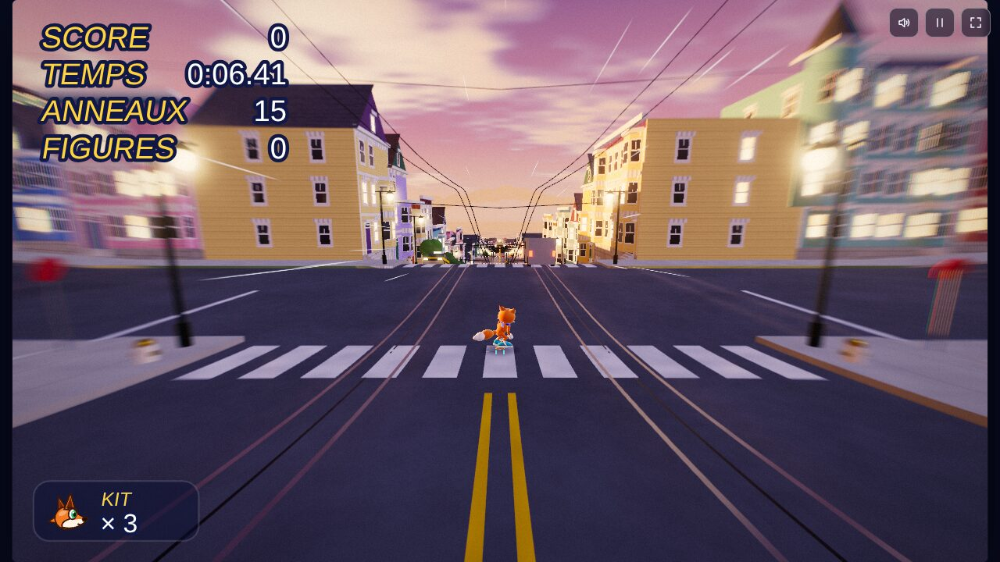
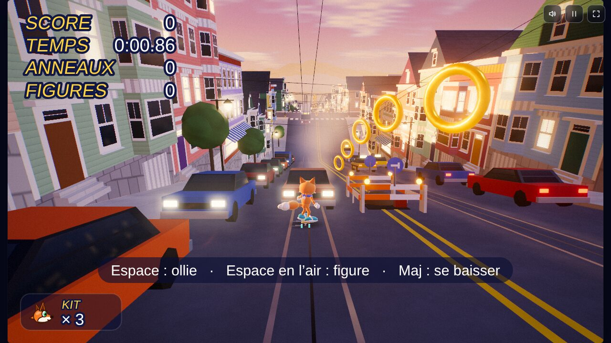
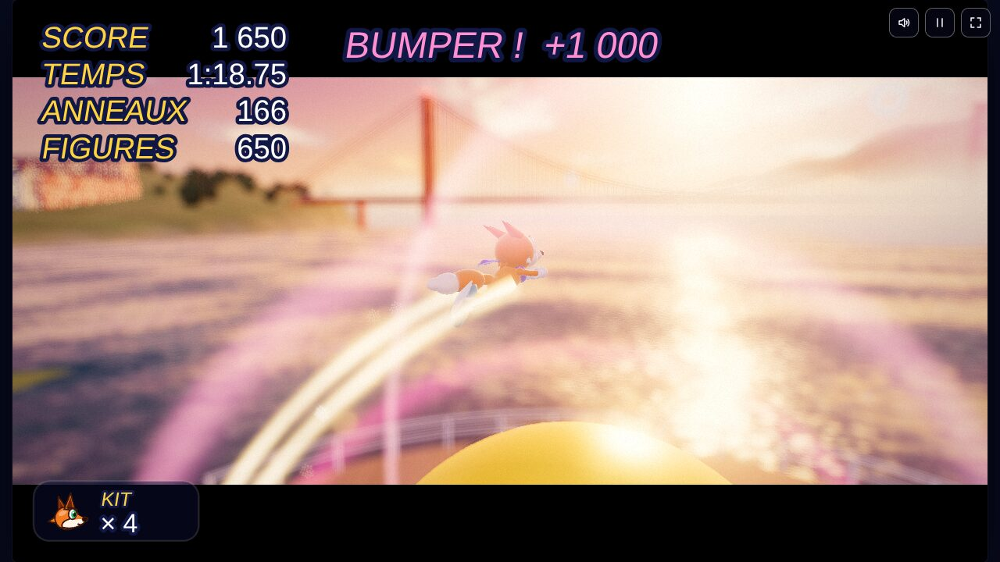
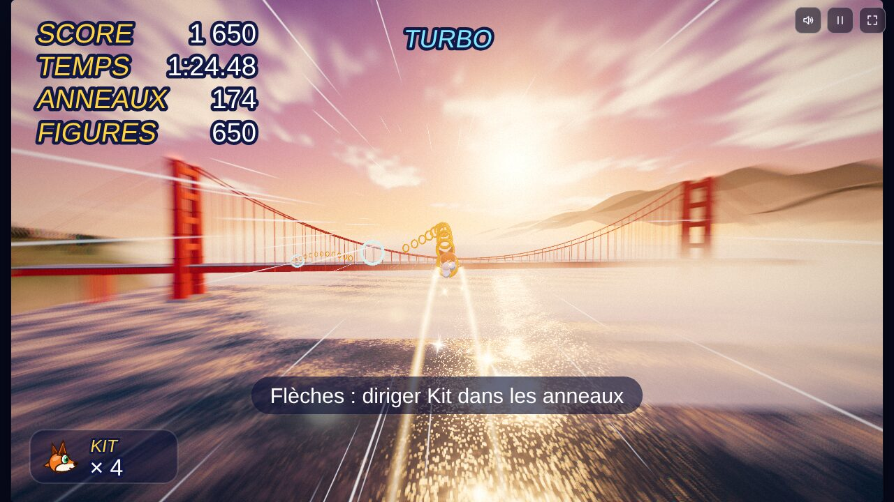

# Kit Rush 3D

Un jeu de plateforme 3D rapide qui se joue directement dans le navigateur, sur PC comme sur téléphone.
Tu incarnes **Kit**, un renard pressé, à travers deux actes :

- **Acte 1 — Collines Émeraude** : collines vertes, loopings, ressorts, ennemis robots et un combat contre le **Dr Boulon**.
- **Acte 2 — San Francisco** : une descente en skateboard dans les rues en pente, au milieu des voitures, des tramways et des chantiers. Au bout de la jetée, un bumper t'envoie voler comme un super-héros au-dessus de la baie, avec un ralenti et un tour de caméra à 360°.



## Jouer

- **En ligne** : https://dje2k1.github.io/Pat3d/ (une fois GitHub Pages activé, voir plus bas).
- **En local** : ouvre `index.html` dans un navigateur récent (Chrome, Edge, Firefox ou Safari). Une connexion internet est nécessaire pour charger three.js depuis un CDN.

Sur l'écran titre, choisis l'acte avec ← → puis appuie sur Espace. Finir l'acte 1 enchaîne directement sur l'acte 2.

## Commandes

| | Clavier | Téléphone | Manette |
|---|---|---|---|
| **Acte 1** — courir | ZQSD / WASD ou flèches | joystick | stick gauche |
| sauter, puis attaque téléguidée en l'air | Espace | SAUT | A |
| rouler / super élan | Maj / Maj + Espace | ROULER / ROULER + SAUT | B ou X |
| caméra | souris ou A / E (Q / E en QWERTY) | glisser l'écran | stick droit |
| **Acte 2** — se pencher, freiner | Q / D (A / D) ou flèches | joystick | stick gauche |
| ollie (maintenir = plus haut) | Espace | SAUT | A |
| figure en l'air | Espace en l'air (+ direction) | SAUT en l'air | A en l'air |
| se baisser | Maj | ROULER | B ou X |
| voler après le bumper | flèches | joystick | stick gauche |
| pause, réglages graphiques | Échap | bouton pause | Start |

Les textes d'aide du jeu s'adaptent à la disposition du clavier (AZERTY ou QWERTY) et à l'appareil utilisé.

## Graphismes

Le rendu vise un aspect « moteur de jeu moderne » :

- image en HDR avec un étalonnage de type film (ACES), halos lumineux (bloom) et rayons de soleil ;
- ombres de contact (en mode Ultra), flou de profondeur pendant les cinématiques, flou de vitesse ;
- étincelles et traînées lumineuses aux sauts, attaques, atterrissages et figures.

Le menu Pause propose quatre niveaux de qualité (**Ultra**, **Élevé**, **Moyen**, **Économie**) et une option
**Super Résolution** : l'image est calculée en plus petit puis agrandie et ré-affinée, dans l'esprit du DLSS ou du FSR
(le vrai DLSS ne fonctionne pas dans un navigateur). Les réglages sont mémorisés. Si ça rame, passe en Moyen ou en Économie.

| | |
|---|---|
|  |  |
|  |  |
|  |  |
|  | |

## Organisation du code

Le jeu tient en une seule page HTML, assemblée à partir des fichiers de `src/` :

| Fichier | Rôle |
|---|---|
| `src/00-shell.html` | page, styles, interface (HUD, boutons tactiles), chargement de three.js |
| `src/10-core.js` | boucle de jeu à 60 Hz fixes, entrées clavier/tactile/manette, audio et musique générés |
| `src/15-post.js` | post-traitement HDR, bloom, Super Résolution, niveaux de qualité |
| `src/16-vfx.js` | particules et effets spéciaux |
| `src/20-world.js` | décor de l'acte 1 (terrain, ciel, eau, loopings) |
| `src/25-city.js` | ville de l'acte 2 (rues, maisons, circulation, jetée) |
| `src/30-player.js` | Kit : physique, animations, caméra |
| `src/35-board.js` | skateboard, figures et vol après le bumper |
| `src/40-entities.js` | anneaux, ennemis, ressorts, boss |
| `src/90-main.js` | écrans, enchaînement des actes, menus, résultats, records |

`docs/SPEC.md` et `docs/SPEC2.md` décrivent la conception en détail (en anglais).

### Construire

```sh
./build.sh
```

Le script vérifie chaque fichier et produit :

- `index.html` : la page jouable (celle publiée sur GitHub Pages) ;
- `kit-rush-3d.html` : la même page au format Artifact de Claude ;
- `test.html` : une version pour les tests (non versionnée).

### Tester

```sh
npm install
npx playwright install chromium
./build.sh
npm test
```

`test/e2e.js` lance le jeu dans Chromium sans écran et joue les deux actes (74 vérifications : parcours, boss,
skateboard, vol, post-traitement, effets, mobile). three.js est servi depuis `vendor/`, donc les tests n'ont pas besoin
d'internet. Compte environ 9 minutes.

## Activer GitHub Pages

Dans le dépôt sur GitHub : **Settings → Pages → Build and deployment**, choisis **Deploy from a branch**,
puis la branche **main** et le dossier **/ (root)**, et clique sur **Save**. Après une minute ou deux, le jeu est en
ligne à l'adresse https://dje2k1.github.io/Pat3d/.

## Crédits

- Personnages, niveaux, musique et effets sonores originaux, créés avec Claude (Anthropic).
- [three.js](https://threejs.org) r128, licence MIT (copie dans `vendor/` pour les tests).
- Police [Lilita One](https://fonts.google.com/specimen/Lilita+One) via Google Fonts, licence SIL Open Font.
